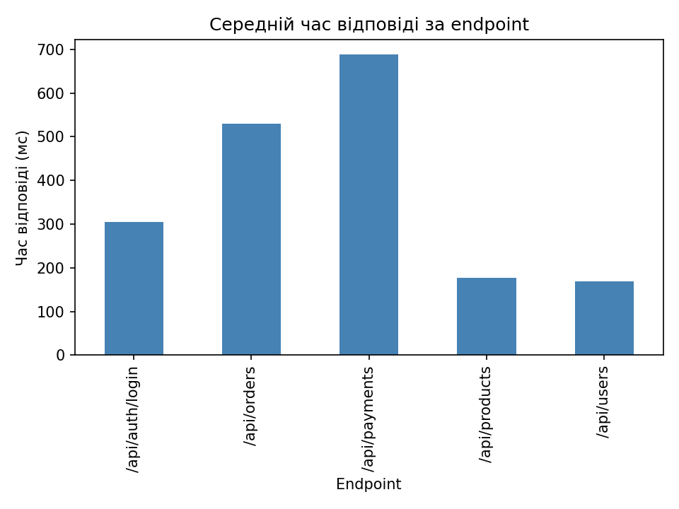

# Аналіз результатів тестування REST API

## Опис проєкту
Навчальний аналіз синтетичного набору даних результатів тестування REST API у хмарному середовищі Google Colab за допомогою бібліотек Python (`pandas`, `matplotlib`).

## Структура репозиторію
- `notebooks/` — Jupyter Notebook із кодом завантаження, обробки та візуалізації даних
- `data/` — навчальний набір даних `api_tests.csv`
- `docs/` — збережена діаграма результатів аналізу `chart.png`

## Як запустити
1. Натисніть кнопку **Open in Colab** у верхній частині цього файлу.
2. У меню Google Colab виконайте **Runtime → Run all** (або **Виконати → Виконати всі**).

## Дані
Набір даних є навчальним та вигаданим (синтетичним), містить 30 записів та 5 полів:
- `endpoint` — кінцева точка API (`/api/users`, `/api/orders`, `/api/payments`, `/api/products`, `/api/auth/login`)
- `method` — HTTP-метод запиту (`GET`, `POST`, `PUT`, `DELETE`)
- `status_code` — код статусу відповіді сервера (`200`, `201`, `400`, `401`, `404`, `500`)
- `response_ms` — час відповіді сервера у мілісекундах
- `date` — дата виконання тесту

## Результати

## Автор
Баран Максим, група ПІ-25-01
